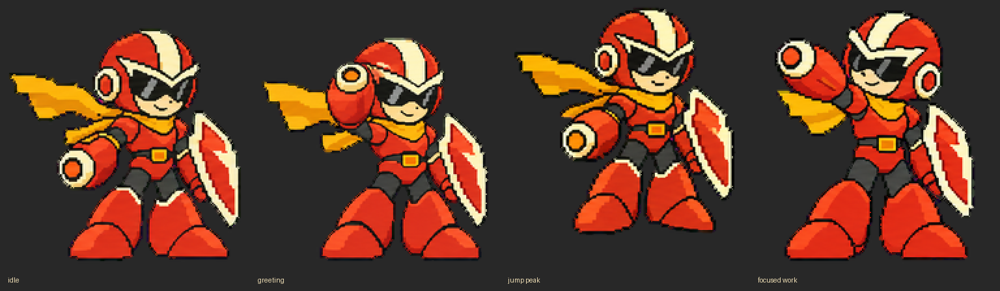
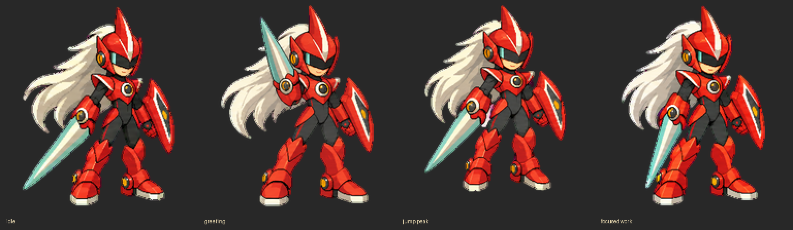

# codex-pets

Two Gruvbox pixel-art companions: **Blues** and **Blues.EXE**.

| Blues | Blues.EXE |
| --- | --- |
|  |  |
| [Animated preview](pets/blues/preview.gif) · [Video](pets/blues/preview.mp4) | [Animated preview](pets/blues-exe/preview.gif) · [Video](pets/blues-exe/preview.mp4) |

Classic Blues uses the original approved design with plain red boots and no leg reflectors. Blues.EXE retains the silver hair, opaque visor, cyber blade, and crimson armor. Each has nine animation states and sixteen look directions.

## Use on another machine

1. Clone this private repository while signed into GitHub with access:

   ```sh
   gh repo clone visualbam/codex-pets
   cd codex-pets
   ```

2. Open the cloned folder in Codex and enable the Pets plugin.
3. Send this request:

   > Use the Pets plugin to import the two existing validated v2 sprite sheets listed in pets.json as Blues and Blues.EXE, then select Blues. Check my pet collection first and reuse an existing matching pet instead of creating duplicates. Preserve the supplied artwork; do not regenerate it. Validate the exact PNG files before upload.

The repo carries the artwork, not an installed or selected pet. Cloning alone does not activate it. Import/select through the Pets plugin on the destination machine. If both pets already appear in your destination account's collection, select the existing pet instead of importing again. Original pet IDs are account-specific and intentionally omitted from the portable manifest.

The Pets plugin used for creation supports these v2 sheets. Other import surfaces may support different formats; do not crop or resize these files to work around a version mismatch. See the [Pets documentation](https://learn.chatgpt.com/docs/pets) for the destination interface.

## Verify the files

On macOS or Linux:

```sh
shasum -a 256 -c SHA256SUMS
```

The sheets are transparent PNGs, exactly 1536 × 2288, with 192 × 208 cells. `pets.json` records the layout, names, file sizes, and SHA-256 digests. Both byte-identical sheets passed the bundled pet quality checks, blind cardinal review, visual review, and Pets preflight before creation.

## Contents

This repository contains the final portable sprite sheets and previews. Generation experiments and rejected revisions are kept in the original creation workspace rather than this installation bundle. No credentials, expiring download links, or upload sessions are included. Git LFS is not required for these files.
